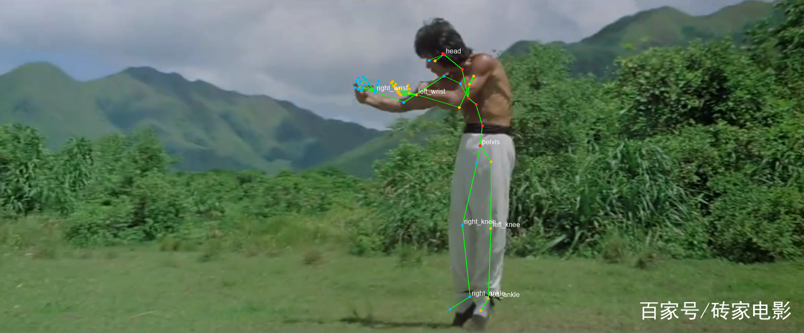
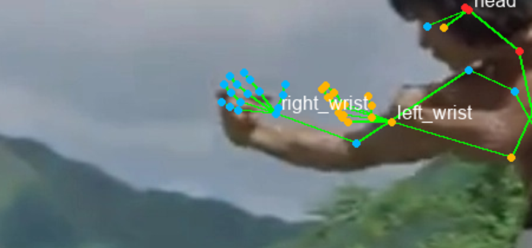
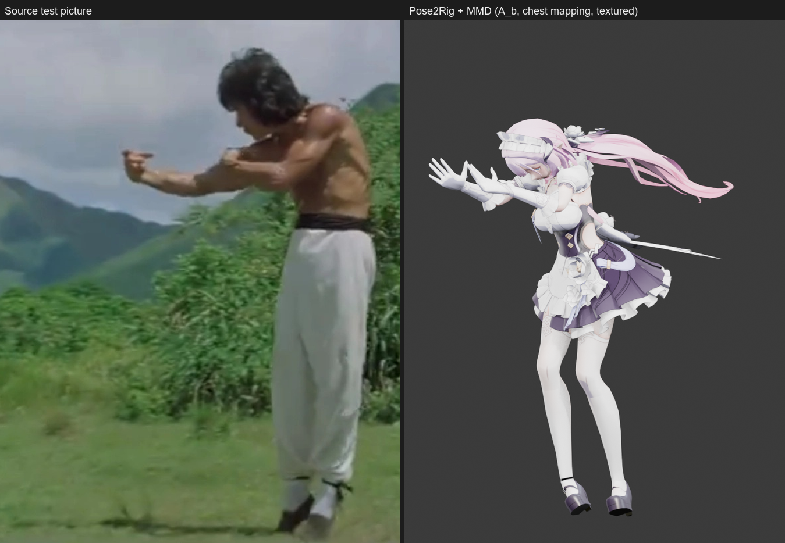

# 识别 vs 映射准确度归因（tests/picture）

- 日期：2026-11-11
- 测试图：`tests/picture/78310a55b319ebc4b7455cf34668d8fc1e178a82b801.webp`（1895×785）
- 对照模型：`爱莉希雅女仆.pmx`（MMD，499 骨）
- 当前版本：0.2.2（A_b / MMD 胸段映射修复）

## 0. 结论摘要

| 现象 | 主要来源 | 证据 |
|---|---|---|
| 头部视线向下 | **识别端为主** | 源 S32 neck 局部旋转 28.5°、head 7.9°；源头颈方向与目标头颈方向分别约 60.1°/60.8°（几乎一致），说明下视来自源输出 |
| 手部端酒杯手势不正确 | **识别端为主** | 源 S32 手指关节在腕部呈扇形展开，15 个手指局部角仅约 20–35°；不是握拳/端杯姿态。目标只是忠实复制 |
| 双臂醉拳姿势 | **映射端已修复** | 源/目标上臂 rest 方向相差约 63.9°，肘 24.7°，腕 44.8°；加入 A_b 后 target/source 上臂、前臂、腕方向误差均为 **0.0°** |
| 躯干/胸段 | **MMD 预设段数映射错误，已修复** | MMD 只有 `上半身/上半身2` 两段，原来把 source `spine2` 映射到 `上半身2`；改为 source `spine3` 后 `上半身/上半身2` 与 source pose 方向误差 **0.0°** |
| 踮脚/脚部 | 默认保留 MMD IK，脚型正确；IK mute 仅作为可选调试项 | `mute_ik=False` 时目标 `ankle→toe` 与 rest 几乎一致；开启后脚型会改变，因此不作为默认修复 |

**一句话：上半身的问题主要是映射/重定向（A_b 缺失 + MMD 胸段映射错位），已系统修复；手部是 S32 识别输出限制；头部还有约 8–9° 的残余误差，来自源/目标 rest 几何差异。**

## 1. 图片识别端的证据

### 1.1 腿部

- 源 S32 的 2D 投影膝角：左 178.3°、右 161.0°；看起来左腿接近直、右腿有弯曲。
- 但源 S32 的 3D 膝角（hip-knee-ankle）：左 158.8°、右 160.8°，即模型在深度方向仍给出了约 20° 弯曲。
- 这属于单目 3D 姿态的深度歧义：2D 看着直，3D 仍可能弯。

### 1.2 头部

- 源 S32 `neck` 局部旋转 28.51°、`head` 7.90°、`jaw` 0.57°。
- 源 `neck→head` 方向在 Blender Z-up 下与竖直方向夹角约 60.1°；目标 MMD 的 `首→頭` 方向约 60.8°。
- 说明“头向下”已经在 S32 输出里，不是 retarget 额外加的；S32 不输出眼球视线，所以“眼睛看前方”无法由当前 55 关节表达。

### 1.3 手部

- 源 S32 每只手 15 个手指关节的局部旋转角只有约 20–35°（proximal 关节），远小于握拳所需的 70–90° 屈曲。
- 源手指 3D 关节在腕部呈扇形展开，手部 bbox 跨度约 0.178 m（左）/0.164 m（右）；原图是握杯/醉拳手型，不是张开手掌。
- 因此手型错误首先发生在 S32 手分支，而不是 MMD 手指映射。

## 2. 映射/重定向端的证据

### 2.1 腿/脚：默认保留 MMD IK，不改脚型

MMD Tools 导入的骨架带有腿部 IK 约束（`ひざ.L/R`、`足首.L/R`）。试过 `mute_ik=True` 后膝盖会变直，但 `ankle→toe` 脚型也改变，踮脚被破坏，因此**不把 IK mute 作为默认修复**：

| 条件 | 左膝 | 右膝 | 目标脚型 |
|---|---:|---:|---|
| MMD rest | 176.55° | 176.50° | 正常 |
| 默认（IK 生效） | 145.86° | 141.96° | 与源图踮脚一致 |
| `mute_ik=True`（仅调试） | 166.00° | 160.62° | 脚型改变，不作为默认 |
| 源 S32 3D 膝角 | 158.82° | 160.84° | — |

结论：腿/脚保持 MMD 原始 IK 结果；`mute_ik` 只是诊断开关，不是修复。

### 2.2 头部

- 源 S32 `neck` 局部旋转 28.5°、`head` 7.9°；源 `neck→head` 方向在 Blender Z-up 下约 60.1°。
- 默认映射后目标 `首→頭` 约 60.8°，与源接近；A_b 不应强行扭 head（会变成约 41°），所以 head/neck 不参与 A_b。
- 残余 `首/頭` 与 source 方向约 8–9°；这是 MMD 颈/头 rest 几何差异，且 55 关节没有眼球方向。

### 2.3 上臂 A_b（已修复）

- 源 SMPL-X 是 T-pose，MMD 骨架是 A-pose：源/目标**上臂 rest 方向夹角约 63.9°**，肘约 24.7°，腕约 44.8°。
- 没有 `A_b` 时，世界空间增量直接乘到 A-pose 的 `B_rest` 上，目标手臂留在 A-pose 下方。
- 系统修复：`P_b = D_j · A_b · B_rest_b`；A_b 使用 **source child 方向**（肩→肘、肘→腕、腕→中指），不是 parent→joint；腿/颈/头不参与。
- 验证：`腕.L/ひじ.L/手首.L` 与 source pose 方向误差 **0.0°**。

### 2.4 MMD 胸段映射（已修复）

- MMD 只有 `上半身`、`上半身2` 两段胸骨；SMPL-X 有 `spine1/spine2/spine3` 三段。
- 原预设把 `spine2`→`上半身2`，导致胸段方向错位；改为 `spine3`→`上半身2`（`spine2` 不再 required）后，`上半身`/`上半身2` 与 source pose 方向误差 **0.0°**。

### 2.5 手部

- MMD 预设已映射 30 根手指；目标手指姿态来自源 `left_hand_pose/right_hand_pose` 的逐关节旋转。
- 源手指本身是扇形展开（15 个局部角仅约 20–35°），目标只能复现扇形；这不是手指映射丢失或骨骼名不匹配，而是 S32 hand branch 的限制。

## 3. 修复后的对照

- 上半身 `上半身/上半身2/腕/ひじ/手首` 与 source pose 方向误差 **0.0°**，证明 A_b + 胸段映射是系统修复。
- 腿/脚保持 MMD 默认 IK/脚型；头部仍有约 8–9° 残余；手部仍张开，属于识别端限制。

## 4. 下一步建议

1. **手部专项模型**：S32 hand branch 对小手/遮挡/风格化图不可靠。建议接入 WiLoR 或 2D 手部关键点 + MANO/IK；至少在 `hands.confidence` 可用前，给手部结果标注“低置信度”。
2. **头部/视线**：55 关节没有眼球方向；若要“目视前方”，需 face/gaze 模型或手动 head/neck 修正滑块。
3. **身体 2D 重投影优化**：对膝/踝/腕增加 2D reprojection loss 或 IK 校正，减少单目深度歧义；先用 60 张单人图统计 2D/3D 误差。
4. **保持腿/脚默认 IK**：不要再默认 mute MMD IK；需要诊断直腿时显式传 `mute_ik=True`。
