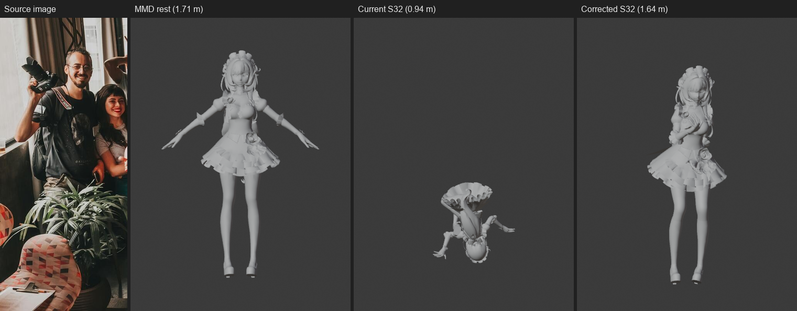

# Pose2Rig 审查问题分析（第一轮）

- 日期：2026-11-11
- 输入：`docs/feature_audit_20261111.md`、当前源码、真实 S32 输出 `_models/smplerx/last_pose.json`
- 方法：逐行代码复核 + 真实数据前向运动学复算 + Blender 5.2.2 真实 MMD 模型对照实验
- 本文是修复前的问题分析；修复实施与测试结果见 `fix_report_20261111.md`。

## 0. 结论速览

审查报告里的问题可以归成四类，而不是一堆互不相关的 bug：

| 类别 | 包含问题 | 本质 |
|---|---|---|
| A. 坐标系契约缺失 | P0-1 姿态翻倒；相机位置/朝向错误；Rest Pose Offset 无效 | 同一份 `pose_result/v1` 里混用了 SMPL-X 模板系、相机系、Blender 骨架系，边界没有显式变换 |
| B. 输入有效性缺失 | P0-2 半身图；P1-4 多人 | 模型永远返回 55 关节，但没有任何“哪些关节真的可见”的质量门 |
| C. 状态语义不成立 | P0-3 Preview/Apply/Cancel；Euler 无法恢复；场景副作用 | Generate 已经写目标骨架，所谓“预览”只是先写后撤；快照只存四元数通道 |
| D. 数值与覆盖缺口 | P1-3 姿态滑块；P1-2 VRM 手指；P2 诊断字段 | 局部实现错误或预设不完整，不涉及架构 |

最重要的判断：**SMPL-X 的输出数据本身在相机空间是自洽的**。我对 `last_pose.json` 做前向运动学复算：

- 55 关节；
- pelvis 旋转 177.40°；
- 相机空间 bbox 为 `[-0.248,-0.739,36.326] .. [0.454,0.801,36.884]`，三个方向尺寸约 `0.70 × 1.54 × 0.56 m`；
- 其中 Y 方向 1.54 m 正好是站高（相机 Y 向下，所以头在 -0.71、脚在 +0.70）。

所以问题不在“SMPLer-X 输出错了”，而在**插件把相机空间姿态直接当成 Blender 世界空间姿态**。这也解释了为什么 Mock 测试全绿：Mock 的 root 近似单位旋转，不需要这套变换也能“看起来对”。

## 1. 问题 A：坐标系与 Rest Pose（P0-1）

### 1.1 三个坐标系

当前链路实际涉及三个不同的坐标系：

| 坐标系 | 轴向 | 当前出现在哪里 |
|---|---|---|
| SMPL-X 模板系 | X 右、Y 上、Z 前 | `source_skeleton.rest_positions`、`rest_rotations`（全单位矩阵） |
| 相机系（OpenCV） | X 右、Y 下、Z 前 | `local_pose_rotations` 的链式结果、`camera.fx/fy/cx/cy`、`cam_trans` |
| Blender 骨架系 | X 右、Y 深处、Z 上 | `target_rest = bone.matrix_local`，MMD/VRM 的 Z-up 骨架 |

`pose_result/v1` 只写了 `conventions.camera = "x_right_y_down_z_forward"`，没有写 `source_skeleton` 的静息朝向，也没有写“相机系 → Blender 世界”的变换。

### 1.2 当前代码做了什么

1. `worker/engines/smplerx.py:81-93`：把 `global_orient/body_pose/...` 的轴角逐个转矩阵，按 55 关节顺序填进 `local_pose_rotations`。
2. `core/retarget_math.py:78-88`：`source_world()` 从 `rest_rotations`（全是单位矩阵）开始，把 `local_pose_rotations` 连乘成源世界旋转 `S_i`。
3. `core/retarget_math.py:91-99`：`D_i = S_pose_i · S_rest_i⁻¹`。因为 `S_rest = I`，所以 `D_i = S_i`。
4. `core/retarget_math.py:102-119`：`P_b = D_j · B_rest_b`，直接把相机空间的旋转增量乘到 Blender 目标骨架的 rest 矩阵上。

这等于假设“源骨架的 rest 朝向 = Blender 目标骨架的 rest 朝向 = 单位矩阵”。对 Mock 的合成 Y-up 骨架勉强成立，对真实 SMPL-X + Z-up MMD 骨架完全不成立。

### 1.3 正确公式（最小改动版）

先明确两个常量矩阵：

- `B = [[1,0,0],[0,0,1],[0,-1,0]]`：相机系（X 右、Y 下、Z 前）→ Blender 世界（X 右、Y 深处、Z 上）。
- `R_rest_cam = R_x(180°) = diag(1,-1,-1)`：SMPL-X 模板的 T-pose 在相机系里的静息朝向（模板 Y-up → 相机 Y-down）。

对每个关节 `j`：

```text
S_j^cam   = Π_{k≤j} L_k                    # 当前 local_pose_rotations 的链式结果，已是相机系
D_j^cam   = S_j^cam · (R_rest_cam)^T       # 扣掉源骨架静息朝向
D_j^world = B · D_j^cam · B^T              # 换到 Blender 世界系
P_b       = D_j^world · B_rest_b           # 再套目标骨 rest
```

其中第二步是关键：**只做 `B · S · B^T` 不够**，因为源骨架的 rest 并不是单位旋转；必须同时扣掉 `R_rest_cam`。用真实数据验证：单独 `B·S·B^T` 时 pelvis 仍是 177.4°（仍翻倒）；加上 `R_rest_cam` 后 pelvis 变成 11.3°、spine1 17.5°、髋 17.0°、膝 25.9°——是正常站姿的数量级。

### 1.4 实验验证：MMD 真实模型

对 `爱莉希雅女仆.pmx`（499 骨，25,595 顶点）应用 `last_pose.json`：

| 条件 | evaluated mesh bbox Z | 高度 |
|---|---|---:|
| rest | -0.002 .. 1.705 | 1.707 m |
| 当前代码 | -0.294 .. 0.641 | 0.935 m（翻倒/蜷缩） |
| 修正公式（本文） | -0.003 .. 1.640 | 1.643 m（正常站姿） |



- 左一：输入图；左二：MMD rest；左三：当前 S32；右一：修正公式后的 S32。
- 修正后的手臂姿态来自源图（抱臂/持物），不是 T-pose 残留；关键是骨盆、脊柱、腿已经回到直立。
- 复现脚本：`_research/audit_fix_probe.py`。

### 1.5 推荐的数据契约改法

不要只在一个函数里补矩阵。建议把 `pose_result/v1` 的坐标系写清楚，否则下一个引擎还会踩同样的坑：

```json
"conventions": {
  "units": "m",
  "rotation": "row_major_3x3",
  "skeleton_frame": "camera",
  "camera_frame": "opencv",
  "world_up": "Z"
}
```

并约定：

1. `source_skeleton.rest_rotations[i]` 是该关节在 skeleton_frame 下的世界静息旋转。SMPL-X 路径填 `R_rest_cam = R_x(180°)`（55 个关节都填同一个，保持刚体一致）。
2. `local_pose_rotations[root]` 改为相对该静息朝向的局部旋转：`L_root' = R_rest_cam^T · global_orient`。其它 body/hand local 不变（SMPL-X 的 body_pose 本来就是相对 rest 的）。
3. `compute_target_basis()` 增加 `world_from_source` 参数（相机系→Blender 的 `B`），在 `world_deltas` 之后做 `B·D·B^T`。
4. Mock/Blender 原生引擎的 `skeleton_frame = "world"`、`B = I`，保持现有测试不受影响。

这套改法的好处是：`source_world()/world_deltas()` 的数学不变，只在边界多两个常量矩阵；Mock 和真实引擎可以共用同一套 retarget 代码。

### 1.6 为什么现有测试发现不了

- `tests/unit/test_retarget_math.py:52-59` 的 `test_rest_offset_is_cancelled` 确实覆盖了“source rest 非单位”的情况，但真实适配器从未把 `rest_rotations` 填成非单位；这个测试是“算法单元测试”，不是链路测试。
- Mock fixture 的 root 旋转接近单位；合成 headless 骨架是 Y-up；两者都不需要 `R_rest_cam`。
- 没有“世界空间 golden pose”断言（例如：给定一个已知 T-pose，目标 pelvis/脊柱/脚趾的 Z 值必须落在合理范围）。

## 2. 问题 A 的第二个入口：相机也是同一类错误

`core/camera_builder.py:29-38` 的 `_camera_pose_from_model_to_camera()`：

```python
r_inv = r.inverted()
location = -(r_inv @ t)
cv_to_blender = Matrix(((1, 0, 0), (0, -1, 0), (0, 0, -1)))
rotation = r_inv @ cv_to_blender
```

它只做了“OpenCV 相机局部轴 → Blender 相机局部轴”，但漏了“OpenCV 世界 → Blender 世界”的 `B`。当 `model_to_camera` 的旋转为单位时，相机位置变成 `(-Tx, -Ty, -Tz)`，而设计文档 §6.1 要求 `(-Tx, -Tz, Ty)`；相机朝向从“沿 +Y 看”变成“沿 +Z 看”，等于从角色脚底往上看。

用 `last_pose.json` 的相机参数做纯数学投影，得到：

| 相机实现 | 投影 bbox（像素，330×759） | 人物高度 |
|---|---|---:|
| 当前代码 | x 78.2..331.4, y 374.5..579.0 | 204.5 px |
| 设计文档 §6.1 | x 76.3..334.2, y 160.7..724.9 | 564.1 px |
| 直接按相机内参投影（基线） | x 76.3..334.2, y 160.7..724.9 | 564.1 px |

设计公式与直接内参投影逐像素一致，当前代码把人物压到画面中间一小块。修正：

```python
B = Matrix(((1, 0, 0), (0, 0, 1), (0, -1, 0)))
location = B @ (-(r_inv @ t))
rotation = B @ r_inv @ cv_to_blender
```

这也会让“自动相机”和“背景垫图”真正对齐；否则即使姿态修好了，相机视角仍然是错的。

## 3. 问题 A 的第三个入口：Rest Pose / A-pose（P1-1）

审查报告说“§6.3 的 ΔR_offset 未实现”，这句话需要拆开看：

- §6.3 的公式本身等价于 `P_b = S_pose · (S_rest⁻¹ · T_rest)`，而当前代码的 `D_j · B_rest_b` 在 `S_rest = I` 时就是 `S_pose · B_rest_b`。所以缺的不是“再乘一个 ΔR_offset”，而是 `S_rest` 这个输入一直是单位矩阵。
- 对虚拟的 SMPL-X 源骨架，没有 Blender 的 `matrix_world` 可读；必须显式提供 `R_rest_cam`（见 §1.5）。直接把设计文档的 `M_obj,S · B_matrix_local` 照抄过来，在这个架构里没有对象可取。
- `_rest_arrays()`（`core/blender_retarget.py:107-115`）只读 `bone.matrix_local`，没有乘 `armature.matrix_world`。如果用户的 Armature 对象有旋转/缩放（FBX/MMD 导入很常见），rest 和目标世界还会再差一层。修正：`rest_world = (armature.matrix_world @ bone.matrix_local).to_3x3()`，再正交化。
- `A_b`（语义骨方向对齐）是独立问题：它处理脚掌 yaw、锁骨方向、不同 DCC 骨骼轴向约定，不是当前“翻倒”的原因。建议先修 frame + rest，再用 `A_b` 做局部质量优化，不要把所有问题都塞进一个矩阵。

## 4. 问题 B：半身图与多人（P0-2 / P1-4）

### 4.1 半身图为什么“能跑但不可信”

SMPLer-X 的 `process_bbox()` 会把任意 bbox 扩展成 192×256 的全身比例，模型输出固定 55 关节。半身图不会让模型“少输出腿”，它只会用上半身外观去猜下半身。审查实测：上半身裁切仍返回 55 关节，`hands=true`，膝盖角 28.3°/31.1°，`warnings=[]`。

这不是模型 bug，是产品没有输入质量门。建议在 `pose_result/v1` 增加：

```json
"input_quality": {
  "bbox_xyxy": [x0, y0, x1, y1],
  "bbox_touches_edges": ["bottom"],
  "detected_persons": 1,
  "visible_joint_ratio": 0.62,
  "lower_body_visible": false,
  "warnings": ["lower body is outside the image; leg joints are hallucinated"]
}
```

`visible_joint_ratio` 可以在插件侧用“相机内参 + 55 关节 3D 位置”做 2D 投影，统计落在画面内的关节比例；不需要改模型。若 `lower_body_visible=false`：

- 默认只映射上半身（从 `source_map` 中移除腿部关节），腿部保持 rest；
- UI 显示明确警告，不静默输出全身；
- 可选 `mapping_mode = "full" / "upper_body" / "auto"`，默认 auto。

### 4.2 多人

`_research/repos/SMPLer-X/main/inference.py:87-107` 实际已经拿到 `mmdet_box[0]` 的全部检测框；默认 `multi_person=false` 时直接取第一个/最大 bbox，其它人丢弃。插件拿到的 meta 只有 `bbox`，没有 `num_persons`。

建议二选一：

1. 最小改动：在 `inference.py` meta 里增加 `num_persons`、`bboxes_mmdet`；适配器写入 `diagnostics.warnings`，UI 显示“检测到 N 人，只取最大 bbox”。
2. 产品化：开启 `--multi_person`，输出多个 npz，UI 提供人物选择/缩略图。这个工作量大，建议放到第二阶段。

当前 `person_left.jpg` 本身就是多人和近景，审查用它做“单人姿态质量”样本并不合适；后续质量报告应先用单人、全身、清晰样本。

## 5. 问题 C：Preview / Apply / Cancel（P0-3）

### 5.1 当前真实流程

1. `_start_generate()`（`ui/operators.py:156-195`）只启动 Worker，不创建快照。
2. Worker 返回后 `_poll_generate()` 调 `_apply_pose()`；`_apply_pose()` 在 `ui/operators.py:93-116`：
   - 如果 `_STATE["snapshot"] is None`，此时才 `snapshot_pose(arm)`；
   - 然后立刻 `blender_retarget.apply_pose(...)` 写目标骨架。
3. `Apply`（`ui/operators.py:226-240`）只做 `bpy.ops.ed.undo_push` 并清空 snapshot，没有“提交姿态”的动作——姿态已经写进去了。
4. `Cancel`（`ui/operators.py:243-258`）调 `restore_pose`。

所以准确说法是：**Generate = 立即写姿态并保留一个撤销快照；Apply = 保留；Cancel = 用快照回滚**。这与设计文档“预览只写副本，Apply 才写骨架”不一致。是否要改成真正的非破坏预览，是产品决策：

- 方案 A（推荐，成本低）：承认“就地预览”，把 UI 文案改成 “Generate Preview (writes pose; Cancel to restore)”；Apply/Cancel 保留。
- 方案 B（真正非破坏）：复制一份 armature + 复制 mesh/modifier，预览只写副本；但约束、驱动、材质、形态键都要复制，复杂且容易出错。
- 方案 C：Generate 只计算不写场景，Apply 才写；但用户看不到预览，失去意义。

### 5.2 Euler 无法恢复的根因

`core/pose_state.py:8-17` 只保存：

```python
rotation_mode, rotation_quaternion, location, scale
```

当原骨骼是 Euler 模式时，`pb.rotation_quaternion` 通常不是当前可见旋转（Euler 通道才生效）。`restore_pose()` 先把 `rotation_mode` 设回 Euler，再写 `rotation_quaternion`；写入的值是过期的单位四元数，于是 Euler 旋转归零。审查实测 `EULER_RESTORE=False`。

修正：快照直接存 `pb.matrix_basis.copy()`（4×4，包含 loc/rot/scale，与 rotation_mode 无关），并保存 `rotation_mode`；恢复时先设 mode，再 `pb.matrix_basis = snapshot`。这比逐通道保存稳。

### 5.3 其他状态问题

- 连续两次 Generate 不 Apply：第二次不会更新 snapshot；Cancel 回到第一次之前。如果产品语义是“一次预览会话”，这反而是对的；如果语义是“每次 Generate 可独立撤销”，需要 generation id + 每次新快照。建议明确前者。
- 切换 target armature 后 `_STATE["armature"]` 被覆盖，旧骨架无法 Cancel。应在切换时先恢复旧骨架或拒绝切换。
- 场景副作用：`_apply_pose` 调 `create_or_update_camera()` 会改 `scene.render.resolution_x/y/percentage`、`scene.camera`，并每次 `bpy.data.images.load()`。Cancel 不恢复这些。建议保存 `scene_state = {resolution, camera, ...}`，Cancel 恢复；或者把“Match Camera”拆成独立按钮，Generate 默认不改场景。

## 6. 问题 D：姿态滑块数学（P1-3）

`core/pose_modifiers.py:18-29`：

```python
q_rest = pb.bone.matrix_local.to_quaternion()
q_pose = pb.rotation_quaternion.copy()
q_delta = q_rest.inverted() @ q_pose
q_new = q_rest @ Quaternion(q_delta.axis, q_delta.angle * factor)
```

`pb.rotation_quaternion` 本身就是相对 bone rest 的局部旋转（matrix_basis 的旋转部分），不是世界旋转。再乘 `q_rest` 等于把 rest 朝向重复应用了一次。审查实测：rest 90°X、pose 30°Y、factor 0.5，期望 15°，实际 48.46°，轴也从 (0,1,0) 变成 (0.939,0.344,0)。

正确写法只有两行：

```python
q_pose = pb.rotation_quaternion.copy()
pb.rotation_quaternion = Quaternion(q_pose.axis, q_pose.angle * float(factor))
```

建议把“四元数缩放”提取成纯函数放进 `retarget_math`，加单元测试（不依赖 bpy），再让 Blender 测试只验证调用。

## 7. 问题 D：VRM 手指与预设自动检测（P1-2）

`assets/presets/vrm.json` 只写了 thumb/index 的 12 根手指，缺 middle/ring/pinky 共 18 根。完整计数：

| 预设 | 身体 | 手指 | 合计 |
|---|---:|---:|---:|
| Mixamo | 22 | 30 | 52 |
| MMD | 21 | 30 | 51 |
| VRM | 22 | 12 | 34 |

补齐 VRM 的候选名即可（VRM 0.x / 1.0 两种命名都要）：

```json
"left_middle1": ["leftMiddleProximal", "LeftMiddleProximal", "J_Bip_L_Middle1"],
"left_middle2": ["leftMiddleIntermediate", "LeftMiddleIntermediate", "J_Bip_L_Middle2"],
"left_middle3": ["leftMiddleDistal", "LeftMiddleDistal", "J_Bip_L_Middle3"],
"left_ring1": ["leftRingProximal", "LeftRingProximal", "J_Bip_L_Ring1"],
"left_pinky1": ["leftPinkyProximal", "LeftPinkyProximal", "J_Bip_L_Pinky1"]
```

右侧同理。注意 VRM 1.0 的 `J_Bip_L_Middle1` 与 VRM 0.x 的 `leftMiddleProximal` 不是同一套。

`detect_preset()` 现在是硬编码前缀匹配：MMD 只认 `センター/上半身/左腕/右腕`，不认 `腕.L/腕.R`；VRM 只认 `J_Bip_`，不认小写 `hips/leftUpperArm`。建议改成按预设候选名打分：对每个预设统计 `required_joints` 能命中的数量，取最高且超过阈值者；这样 MMD Tools 的 `.L/.R` 导出和 VRM 的小写命名都能自动识别。

## 8. 问题 D：诊断字段与场景副作用（P2）

| 字段/行为 | 现状 | 建议 |
|---|---|---|
| `diagnostics.timings_ms` | 永远 `{}` | 在 adapter 里记录 preprocess/detect/infer/postprocess 毫秒；至少记录总耗时 |
| `hands.confidence` | 永远 `null` | 如果没有置信度，明确写 `null` 并在文档标注“不支持”，不要伪装 |
| `progress` | 属性存在但从未更新 | Worker 发阶段消息，UI 在 timer 中读；或删掉该属性 |
| `weights_sha256` | Operator 不传 | 从模型文件计算一次并缓存 |
| `WorkerClient` 超时 | 180s，小于 `SmplerXEngine` 的 900s | 统一为配置项（默认 300–900s），慢机器不能先被客户端杀掉 |
| 参考图加载 | 每次 Generate 都 `bpy.data.images.load` | 用缓存；Reset 时释放未使用图像 |
| 相机/分辨率 | 改全局 scene | 拆成独立“Match Camera”操作；或在 Cancel 恢复 `scene_state` |

## 9. 优先级与工作量（建议）

| 优先级 | 工作 | 依赖 | 估算 |
|---|---|---|---|
| P0-1 | 坐标系契约 + retarget frame 修正 + 相机 frame 修正 | 无 | 2–3 天（含回归测试） |
| P0-2 | Preview/Apply/Cancel 状态机 + matrix_basis 快照 | 无 | 1–2 天 |
| P0-3 | 输入质量门（半身/多人/无人） | P0-1 的 2D 投影可用 | 2–3 天 |
| P1-1 | Rest Pose / Armature Object 矩阵 / A_b 微调 | P0-1 | 1–2 天 |
| P1-2 | VRM 手指补齐 + 预设打分检测 | 无 | 0.5 天 |
| P1-3 | 姿态滑块数学修正 + 单元测试 | 无 | 0.2 天 |
| P2 | 诊断字段/进度/超时/场景状态 | P0-2 | 1 天 |

建议顺序：**P0-1 → P1-2 → P1-3 → P0-2 → P0-3 → P1-1 → P2**。P1-2/P1-3 是低风险快速修复，可以先把“明显错误”清掉；P0-1 是真实功能成立的前提，必须最先做。

## 10. 验证方案（修 P0-1 时同步建立）

1. 纯数学单元测试
   - 构造 SMPL-X 风格 3 关节：`rest_rotations = R_x(180°)`，root local = `R_x(180°)^T · R_x(180°)`（即 identity），断言 `compute_target_basis(..., world_from_source=B)` 返回 identity。
   - 构造“站立但 global_orient=R_x(180°)”的 55 关节数据，断言目标 pelvis/spine/leg 的 world Z 方向朝上。
   - Mock 路径：`skeleton_frame="world"`、`world_from_source=I`，断言现有 7 个 headless 测试仍通过。
2. Blender headless 真实模型
   - MMD `爱莉希雅女仆`：rest bbox 1.705 m；修正后任意真实 S32 姿态 bbox 高度应在 1.5–1.8 m（除非源图是蹲姿）；脚底最低点接近 0（ground_snap 后）。
   - 渲染正面图，人工检查骨盆/膝盖/脚踝方向。
3. 2D 重投影
   - 用 `camera_builder` + `world_to_camera_view` 把 55 关节投影回原图，统计与检测 bbox 的重叠率；修复后应明显优于当前（当前相机偏差 360 px 高度）。
4. 回归
   - 19 个单元测试 + 7 个 headless 测试全绿；
   - 真实 S32 跑 `person_left.jpg` 和 `tests/picture` 各一次，记录耗时/bbox/关节数；
   - 连续 3 次 Generate → Cancel，确认每次回到正确状态；Euler 骨骼恢复测试。

## 11. 附：本次新增证据

- `_research/audit_fix_probe.py`：修正公式的 Blender 验证脚本。
- `docs/audit_evidence/fix_compare.png`：输入图 / rest / 当前 S32 / 修正 S32 对照。
- `_research/audit_mmd_corrected_front.png`：修正后正面渲染。
- 复算数据：pelvis 177.3985°；相机空间 bbox 0.701×1.540×0.558 m；MMD rest 1.707 m；当前 S32 0.935 m；修正 S32 1.643 m。

---

**一句话总结**：审查报告发现的不是“模型不会识别”，而是**插件在模型输出之后缺少一层明确的坐标系/静息姿态契约**。把这层契约补上，真实 S32 姿态才能从“字节写进去了”变成“姿势是对的”；其余半身图、Preview、VRM 手指、滑块问题都是在这层契约之上的独立工程质量问题。

